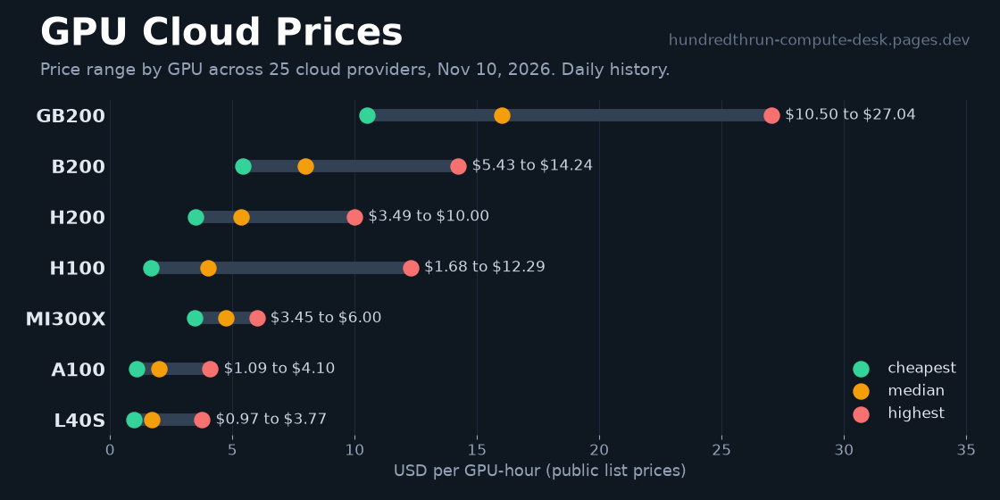

# GPU cloud prices



Public on-demand and listed GPU rental prices from 25 cloud providers (H100, H200, B200, B300, GB200, GB300, A100, L40S, MI300X, MI355X), with a source URL and check date on every row. Normalized to USD per GPU-hour.

This repo is the open data behind the [Hundredth Run compute desk](https://hundredthrun-compute-desk.pages.dev). Live tables, provider pages and a [GPU memory and cost calculator](https://hundredthrun-compute-desk.pages.dev/calculator) are on the site. A JSON API is at [/api/v1/prices.json](https://hundredthrun-compute-desk.pages.dev/api/v1/prices.json).

Also on [Hugging Face](https://huggingface.co/datasets/hundredthrun/gpu-cloud-prices) and [Kaggle](https://www.kaggle.com/datasets/hundredthrun/gpu-cloud-rental-prices), with a quick [cheapest-price browser](https://huggingface.co/spaces/hundredthrun/gpu-cloud-prices) as a Hugging Face Space. To call the JSON API without writing code, fork the public [Postman collection](https://www.postman.com/hundredthrun/hundredth-run-gpu-prices/overview). To query it with SQL in the browser, open the versioned [DoltHub database](https://www.dolthub.com/repositories/hundredthrun/gpu-cloud-prices). To chart the live API in a notebook, fork the [Observable notebook](https://observablehq.com/@hundredthrun/gpu-cloud-rental-prices-live). To try the endpoints in a browser API console, use the free [RapidAPI Hub listing](https://rapidapi.com/HundredthRun/api/hundredth-run-gpu-prices).

## Use it from an AI agent (MCP)

A free remote MCP server answers live price questions in Claude, Cursor or any MCP client. No key.

```json
{"mcpServers": {"gpu-prices": {"type": "http", "url": "https://hundredthrun-compute-desk.pages.dev/mcp"}}}
```

Tools: `list_gpus`, `cheapest_gpu` (for example H100), and `get_prices` (filter by GPU, provider, on_demand, spot or reserved). Every answer carries the source URL and date checked. Docs: https://hundredthrun-compute-desk.pages.dev/open-data

Listed on Glama: https://glama.ai/mcp/connectors/dev.pages.hundredthrun-compute-desk/hundredth-run-gpu-cloud-prices

## Files

| File | What it is |
|---|---|
| `data/gpu_prices.csv` | One row per provider, GPU and price type. Columns include `price_usd_per_gpu_hr`, `price_type`, `term`, `region`, `price_as_listed`, `source_url`, `date_checked`, `fetch_method`, `confidence`, `notes` |
| `data/gpu_prices.json` | The same rows plus `meta` (generated time, per-provider fetch status) |
| `data/lead_times.csv` | Availability and lead-time notes as stated by providers |
| `data/models.csv` | Open model parameter counts used by the calculator, with sources |
| `data/history/<date>.json` | Daily snapshots (since 2026-11-04) of median price per GPU, for tracking changes |

## Starter notebook

[notebooks/gpu-cloud-prices-starter.ipynb](notebooks/gpu-cloud-prices-starter.ipynb) answers five buyer questions with pandas: cheapest on-demand price per GPU, provider spread, spot vs on-demand gap, daily median history, and provider price changes. It reads the files from the [Hugging Face mirror](https://huggingface.co/datasets/hundredthrun/gpu-cloud-prices), so it runs anywhere. [Open in Colab](https://colab.research.google.com/github/hundredthrun/gpu-cloud-prices/blob/main/notebooks/gpu-cloud-prices-starter.ipynb).

## Sources and method

- Prices are read from each provider's public pricing page or official price API. Every row links to the page it came from (`source_url`) and records the date it was read (`date_checked`) and how (`fetch_method`: official API, static HTML, or read by hand).
- Multi-GPU node prices are divided by the GPU count to give a per-GPU-hour figure. The original wording is kept in `price_as_listed`.
- `confidence` is high for API or clearly itemized prices, medium for "starting at" style prices, low when the only price is in an FAQ or similar.
- If a value is not published (region, lead time, a GPU price behind "contact sales"), the field stays blank or `unknown`. Nothing is estimated or filled in.

## How often it is updated

Daily. The refresh re-reads every source, saves a new dated history snapshot and pushes here. The Kaggle and Hugging Face mirrors are republished weekly. If a provider page cannot be read, its old rows are kept and marked stale in `meta.provider_status`.

## Limitations

- These are public list prices, mostly on-demand. Negotiated, reserved, spot and committed-use prices are often much lower and are mostly not covered.
- Prices change often. A row can be a day or more old if a page failed to load. Check `date_checked` and the source before you buy.
- Availability is not guaranteed by a listed price.
- Unknown stays blank. Missing data does not mean free or unavailable.

## Updating (maintainers)

```
python3 scripts/sync_from_desk.py --source /path/to/compute-desk    # copy, commit, push
python3 scripts/sync_from_desk.py --source /path/to/compute-desk --dry-run
python3 -m unittest discover tests
```

The script checks the data has rows and the key columns, copies only changed files, and commits only when something changed.

## License

Data: [CC BY 4.0](https://creativecommons.org/licenses/by/4.0/). Credit "Hundredth Run compute desk" with a link to https://hundredthrun-compute-desk.pages.dev.
Code in `scripts/` and `tests/`: MIT.

Corrections are welcome as issues or pull requests, with a link to the provider page.
